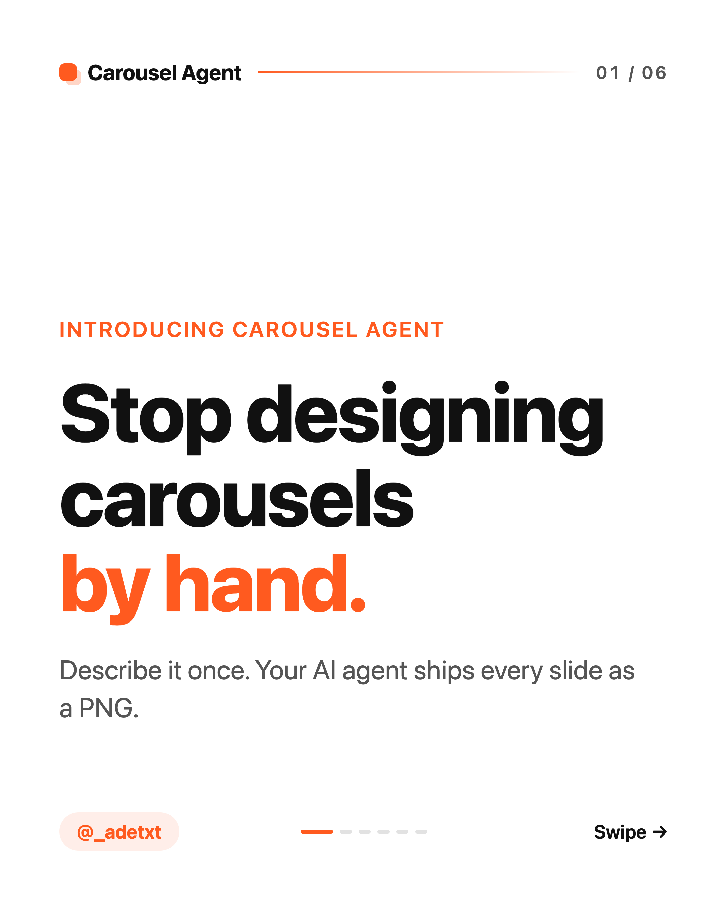
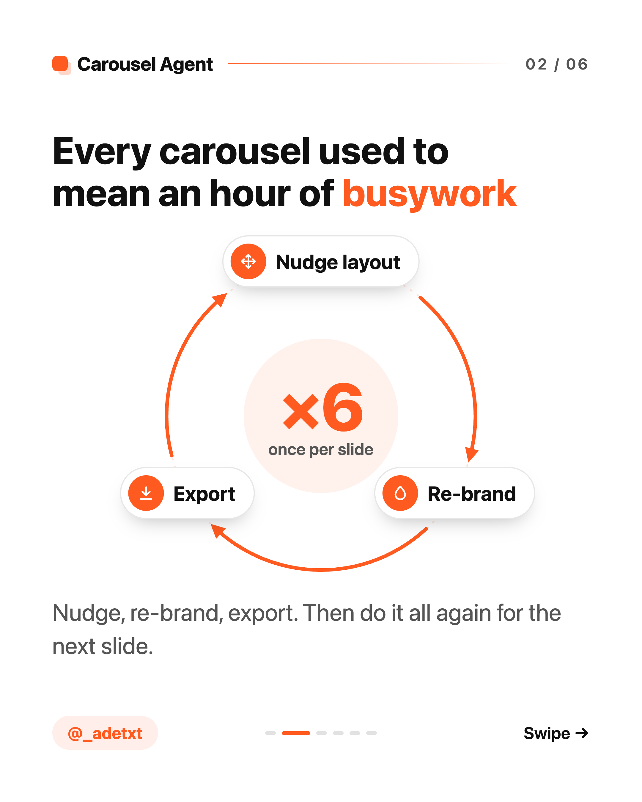
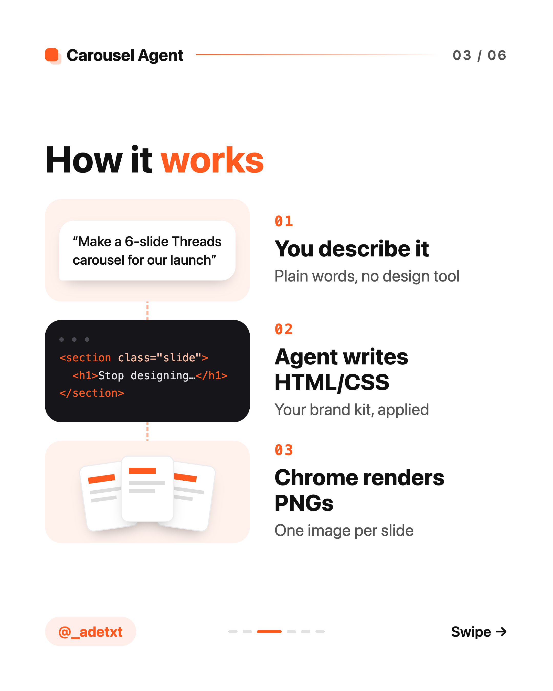
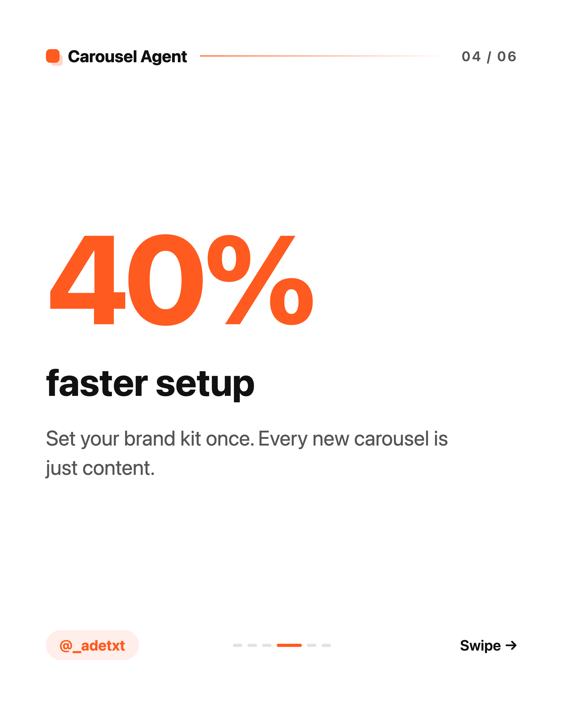
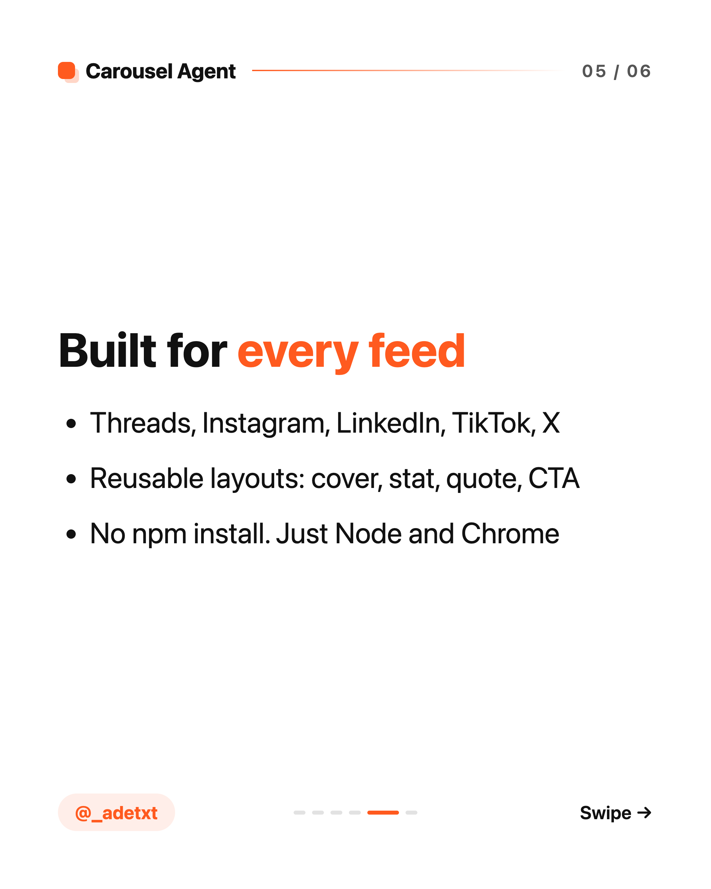

# carousel-agent

**Your next carousel starts with a prompt.**

Carousel Agent is an agent skill that turns a brief into social slides. Your agent writes HTML/CSS, applies your brand kit, and renders each slide as a PNG. Want to change the headline or try another layout? Ask for an edit and render again.

Keep the editable source alongside your content. Reuse your branding across launches, explainers, and tutorials for Instagram, LinkedIn, Threads, TikTok, or X.

## See the slides

A six-slide launch example, using the assets in [`examples/carousel-agent-launch/`](examples/carousel-agent-launch/). Click any slide to view it at full size.

| 01 · The hook | 02 · The problem | 03 · The workflow |
| :---: | :---: | :---: |
| [](examples/carousel-agent-launch/slide-01.png) | [](examples/carousel-agent-launch/slide-02.png) | [](examples/carousel-agent-launch/slide-03.png) |
| 04 · The brand kit | 05 · The features | 06 · The invitation |
| [](examples/carousel-agent-launch/slide-04.png) | [](examples/carousel-agent-launch/slide-05.png) | [](examples/carousel-agent-launch/slide-06.png) |

The “40% faster setup” figure on slide 4 is illustrative copy, not a measured benchmark.

## Install the skill

With the [skills CLI](https://github.com/vercel-labs/skills):

```bash
npx skills add adetxt/carousel-agent
```

Install for all projects, or select an agent explicitly:

```bash
npx skills add adetxt/carousel-agent -g
npx skills add adetxt/carousel-agent --skill carousel-agent -a claude-code
```

The renderer needs **Node.js 22+** and Chrome, Chromium, Edge, or Brave. Set `CHROME_PATH` to use a specific browser. Animated slides also need `ffmpeg` (or `FFMPEG_PATH`). The renderer has no npm dependencies.

## Give your agent a brief

Start with the topic, audience, and format:

> Use carousel-agent to make a 6-slide LinkedIn carousel introducing our new developer tool. Write for engineering leads, use a 4:5 portrait format, and end with an invitation to try the demo. Reuse our existing brand kit.

Then refine it in conversation:

> Make slide 1 more direct. Turn slide 3 into a process diagram. Keep the colors and typography.

The skill guides your agent to reuse the project's kit, write the slides, render them, and inspect every output for clipped text, missing images, and spacing problems. For a new brand, provide your logo, colors, and handle so the agent can set up the kit first.

## What you can make

- Launch posts, explainers, tutorials, and multi-image social posts.
- Covers, stat slides, flow diagrams, quotes, media slides, and closing calls to action with reusable layouts.
- PNGs at the slide's CSS size, or higher resolution with `--scale 2`.
- Animated MP4 slides using CSS, GSAP, or `requestAnimationFrame`. Add `data-duration` to a slide to render it as video.

The default canvas is 1080 × 1350 (4:5). Change the kit's dimensions for square, vertical, or landscape content. MP4 output is a separate file per animated slide; LinkedIn document carousels use static slides.

## Render from a checkout

The agent uses the bundled renderer from the installed skill. To run it yourself from this repository, point it at your carousel's HTML:

```bash
node skills/carousel-agent/scripts/render.mjs carousels/launch.html --out carousels/launch --scale 2
```

For a static carousel on the default canvas, this produces `slide-01.png`, `slide-02.png`, and so on at 2160 × 2700. Your HTML stays editable for the next revision.

```bash
node skills/carousel-agent/scripts/render.mjs --help
```

## Set the brand once

The shared kit holds your logo, colors, typography, layouts, headers, footers, and page numbers. Each new carousel links to that kit:

```text
carousels/
  kit/
    theme.css          # colors, typography, slide dimensions, reusable layouts
    chrome.js          # logo, brand name, handle, page numbers
    logo.svg
  launch.html
  launch/
    slide-01.png
    slide-02.png
```

Change `kit/theme.css` to update the visual style. Configure the `BRAND` object in `kit/chrome.js` for your logo, name, and handle. Add new layouts to the kit so future carousels can reuse them.

## Inside the repo

```text
skills/carousel-agent/
  SKILL.md             # workflow and design guidance for the agent
  scripts/render.mjs   # local browser renderer: one PNG or MP4 per slide
  assets/kit/          # starter brand kit
  assets/example.html  # starter carousel with an animated flow slide
examples/
  carousel-agent-launch/  # the six PNGs shown above
```

Read the [skill instructions](skills/carousel-agent/SKILL.md) for the slide contract, layout markup, animation guidance, and troubleshooting.
