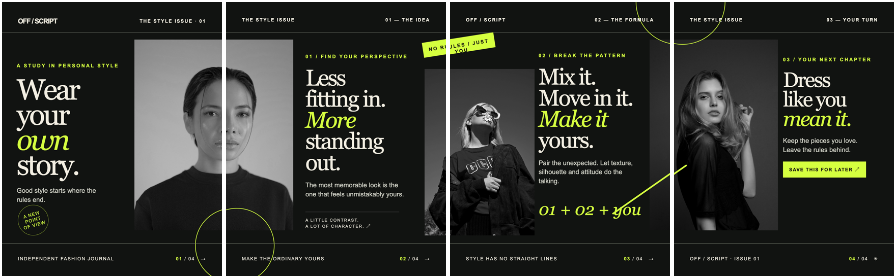
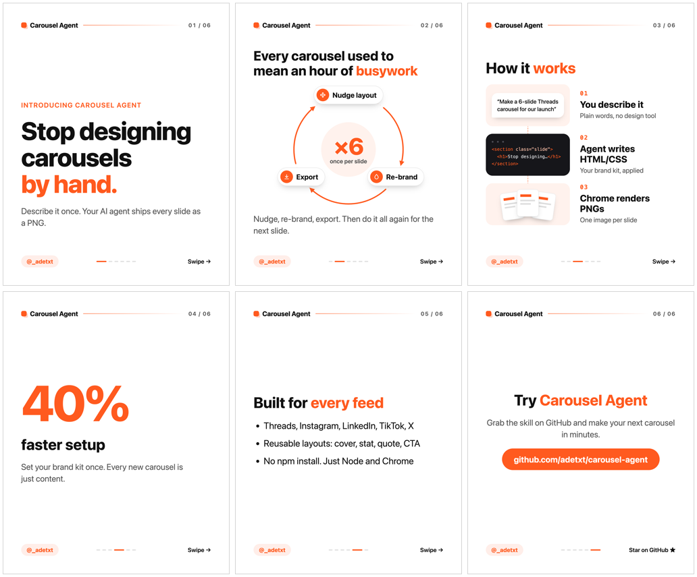

# carousel-agent

**Your next carousel starts with a prompt.**

The [static landing page](docs/index.html) showcases the skill and its examples.
See [hosting instructions](docs/README.md) to preview it or publish it on GitHub Pages.

Carousel Agent turns a brief into social slides. Describe what you want, give your agent a reference or brand kit if you have one, and ask for changes in conversation. Your agent handles the layout, editable source, rendering, and visual inspection.

## Install and update

Install with the [skills CLI](https://github.com/vercel-labs/skills):

```bash
npx skills add adetxt/carousel-agent
```

Update an existing installation:

```bash
npx skills update carousel-agent
```

Add `-g` if you installed the skill globally.

You need **Node.js 22+** and Chrome, Chromium, Edge, or Brave on your machine. Animated slides also need **ffmpeg**. The renderer has no npm dependencies.

## Describe your carousel

Start with a topic, audience, and platform:

> Use carousel-agent to make a 6-slide LinkedIn carousel introducing our new developer tool. Write for engineering leads, use a 4:5 portrait format, and end with an invitation to try the demo. Reuse our existing brand kit.

Or ask for a seamless composition:

> Use carousel-agent to make a four-slide seamless fashion carousel for Instagram. Use free photography, bold editorial typography, and artwork that continues across slide edges. Include a swipeable HTML preview.

Then refine it:

> Make slide 1 more direct. Let the portrait continue into slide 2. Keep the colors and typography.

Your agent creates the files and checks the rendered slides for clipped text, missing images, and spacing problems. Share your logo, colors, and handle for branded content, or ask for a generic design. You can ask for a different ratio, higher-resolution exports, or animation without editing templates yourself.

## See the results

### Seamless fashion editorial

This four-slide example uses Unsplash photography, serif headlines, and lime accents. Photos and graphic elements continue across the slide boundaries; each panel exports as its own 1080 × 1350 PNG.

[](examples/seamless-editorial/overview.png)

[Explore the swipeable preview](examples/seamless-editorial/preview.html).

### Product launch carousel

A six-slide launch example, shown with white borders between panels. Open the overview to view it at full size.

[](examples/carousel-agent-launch/overview.png)

The “40% faster setup” figure on slide 4 is illustrative copy, not a measured benchmark.

## What you can make

- Launch posts, explainers, tutorials, and multi-image social posts for Instagram, LinkedIn, Threads, TikTok, or X.
- Seamless carousels with photography, shapes, and artwork continuing across slide edges.
- Covers, stat slides, flow diagrams, quotes, media slides, and closing calls to action.
- Static PNGs and animated MP4 slides, with editable HTML/CSS source for later revisions.
- Portrait (4:5), square (1:1), vertical (9:16), landscape (16:9), or a custom fixed canvas.

The default size is 1080 × 1350. Every slide in a carousel uses the same dimensions. Animated slides export as separate MP4 files; LinkedIn document carousels use static slides.

## Reuse your branding

Tell your agent which brand kit to use, or provide a logo, colors, typography, and handle. It stores those choices in a shared kit and reuses them across future carousels. Ask for a brand change in conversation when you want to update the style.

## Developer reference

The agent uses the renderer bundled with the installed skill. These details are for running or customizing it yourself from a checkout.

<details>
<summary>Installation options, rendering, and project files</summary>

Install globally or choose an agent:

```bash
npx skills add adetxt/carousel-agent -g
npx skills add adetxt/carousel-agent --skill carousel-agent -a claude-code
```

Render the included editorial example:

```bash
node skills/carousel-agent/scripts/render.mjs examples/seamless-editorial/index.html --out examples/seamless-editorial/slides
```

For higher resolution, add `--scale 2`. For example, a 1080 × 1350 canvas exports at 2160 × 2700. Run `--help` for all options. Set `CHROME_PATH` or `FFMPEG_PATH` to use specific binaries.

The shared kit's `theme.css` owns colors, typography, layouts, and canvas dimensions (`--w` / `--h`). Its `chrome.js` configures optional branding and page numbers. The bundled [seamless starter](skills/carousel-agent/assets/seamless-example.html) demonstrates clipping one wide scene into adjacent panels.

Video slides use `data-duration` and can animate through CSS, GSAP, or `requestAnimationFrame`. Carousels containing video need even output dimensions; use `--scale 2` for an odd canvas dimension such as the 675px landscape height.

```text
skills/carousel-agent/
  SKILL.md                     # agent workflow and slide contract
  scripts/render.mjs           # one PNG or MP4 per slide
  assets/kit/                  # reusable starter kit
  assets/example.html          # starter with an animated flow slide
  assets/seamless-example.html # shared-scene starter
examples/
  carousel-agent-launch/       # six-slide launch example
  seamless-editorial/          # editorial source, preview, photos, and PNGs
```

Read the [skill instructions](skills/carousel-agent/SKILL.md) for the slide contract, animation guidance, and troubleshooting.

Renderer checks require Chrome, ffmpeg, and ffprobe:

```bash
node --test skills/carousel-agent/scripts/render.test.mjs
```

</details>
